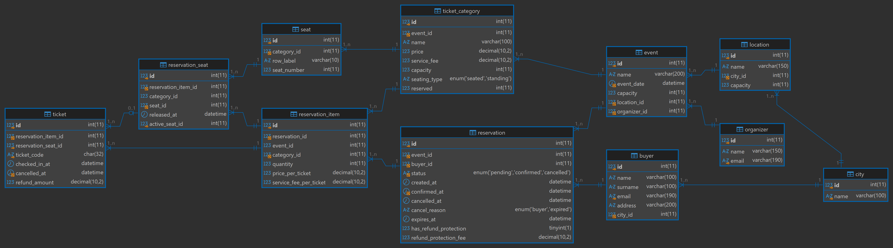

# EventHub

EventHub is a MariaDB database for event ticket reservations, seating, ticket issuance, check-in, cancellations, and refunds. Business rules live in SQL procedures, triggers, and constraints; this repository does not include a web application.

## Database diagram



[Open full-size diagram](eventhub-diagram.png) · [Database structure and decisions](docs/02_database_structure.md)

## Requirements and setup

Use Docker with Docker Compose v2, Git, and Bash (Linux or WSL). Python 3 is needed for performance measurements; DBeaver is optional. Enable Docker Desktop WSL integration if Docker is unavailable in your distro. Port 3306 must be free.

Clone this repository using its Git remote URL, enter its directory, then run:

```bash
cp .env.example .env
```

Set three different passwords in `.env`: `MARIADB_ROOT_PASSWORD`, `EVENTHUB_APP_PASSWORD`, and `EVENTHUB_REPORT_PASSWORD`. Do not overwrite an existing `.env` or commit passwords.

```bash
docker compose up -d
docker compose ps -a
docker compose logs liquibase
```

Wait for `db` to become healthy and `liquibase` to exit with code 0. MariaDB 10.11 stores data in a persistent volume; Liquibase 4.33.0 installs the schema, routines, views, users, and permissions. For failures, inspect `docker compose logs db` and the Liquibase log before proceeding.

Connect to `127.0.0.1:3306`, database `eventhub`. Use `eventhub_app` with its configured password for business procedures and permitted views, `eventhub_report` for read-only table access, or `root` for setup and administration.

```bash
docker compose exec -T db sh -c 'MYSQL_PWD="$EVENTHUB_APP_PASSWORD" mariadb -ueventhub_app eventhub -e "SELECT CURRENT_USER(); SELECT * FROM v_event_capacity LIMIT 5;"'
```

An empty result is expected before loading data. On a fresh database, load the seed once:

```bash
docker compose exec -T db sh -c 'MYSQL_PWD="$MARIADB_ROOT_PASSWORD" mariadb -uroot eventhub' < seed/01_seed.sql
```

The seed produces 8 events and 175 reservations using business procedures and simulated dates in 2026. It is not a repeatable reset script.

## Reproduce the demonstration

Follow the [presentation walkthrough](docs/09_presentation.md). Run seed report verification and create the performance copy before adding demo records. Existing recorded results describe their original datasets, not every later database state.

| Requirement | Source |
| --- | --- |
| ERD, relationships and trade-offs | [Database guide](docs/02_database_structure.md) |
| Successful and rejected reservation | [Demo SQL](tests/09_presentation.sql) |
| Transactions | [Tests](tests/05_transactions.sql), [recorded results](docs/05_transactions_output.md) |
| Concurrent booking | [Script](tests/06_concurrency.sh), [recorded results](docs/06_concurrency_output.md) |
| Reporting | [SQL](reports/01_reports.sql), [verification](reports/02_verify_reports.sql) |
| Optimization | [Measured results](docs/07_performanse.md), `perf/results/series.tsv` |

## Repository map

- `migrations/`: Liquibase changelog and schema/business logic.
- `seed/`: deterministic example data.
- `tests/`: integrity, transaction, concurrency, permission, and presentation scenarios.
- `reports/`: eight reporting queries and seed assertions.
- `perf/`: isolated performance database setup, workloads, runner, and raw evidence.
- `docs/`: guides and historical test evidence (older evidence is in Croatian).

## Maintenance

Run commands from the repository root. After pulling new migrations, run `docker compose up -d`; explicitly apply pending changes to an already running database with:

```bash
docker compose run --rm --no-deps liquibase update
```

Restarting MariaDB alone does not apply migrations. See [migration details](docs/liquibase.md).

`docker compose down` stops the services while retaining data; `docker compose up -d` starts them again. **`docker compose down -v` deletes the persistent volume and both databases.** Changing `.env` does not update passwords already installed in an existing database.

For a persistence check, compare `SELECT COUNT(*) FROM reservation` before and after `docker compose restart db`, waiting for health before reconnecting. Keep real credentials outside Git.
